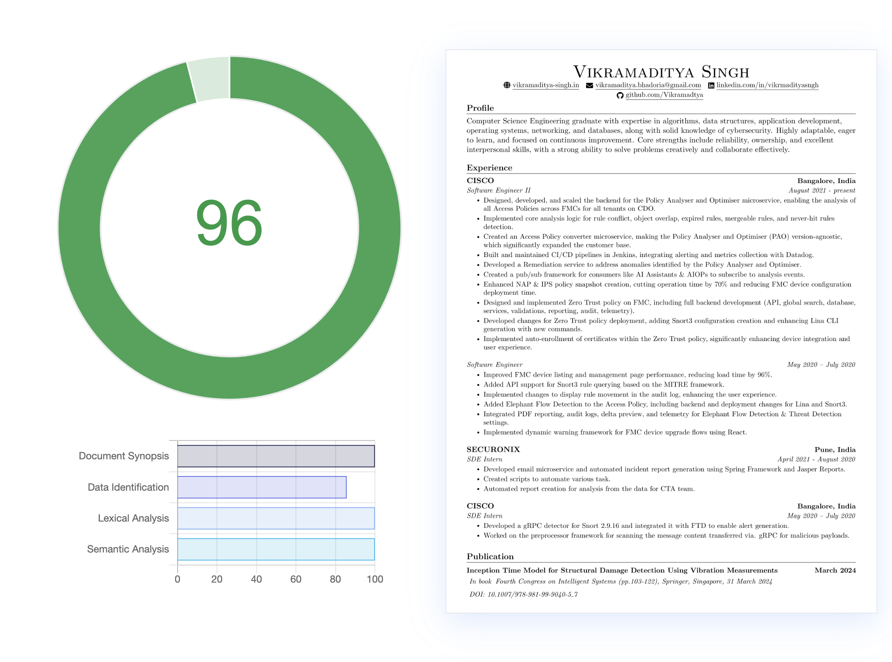

# Resume

Resumes by Vikramaditya Singh, written in LaTeX.

**Live site:** https://vikramadtya.github.io/Resume/

## How it works

Pushing to `main` runs the [build workflow](.github/workflows/build.yml), which compiles both resumes and deploys the PDFs and the viewer in `site/` to GitHub Pages. Compiled PDFs are not committed.

### Versions

Tag a version to publish it as a GitHub Release with both PDFs attached:

```bash
git tag v2026-11 && git push origin v2026-11
```

Older versions are listed under [Releases](https://github.com/Vikramadtya/Resume/releases); the full history is in git.

### Build locally

```bash
cd "Resume 1" && latexmk -pdf main.tex
cd "Resume 2" && latexmk -xelatex main.tex
```

Before the first deploy, set Settings > Pages > Source to **GitHub Actions**.

## Resumes

| Resume | Source | Overleaf |
| ------ | ------ | -------- |
| Resume 1 | [main.tex](Resume%201/main.tex) | [Link](https://www.overleaf.com/project/66f4e67515a2df56ea21a8d1) |
| Resume 2 | [main.tex](Resume%202/main.tex) | [Link](https://www.overleaf.com/project/66f4e67515a2df56ea21a8d1) |

### Score (Resume 1)



## Tools

- Checker: https://www.resumego.net/resume-checker/
- Formatter: https://c.albert-thompson.com/latex-pretty/
